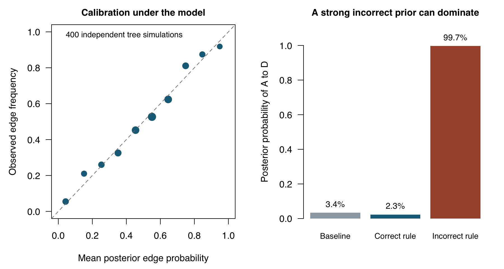
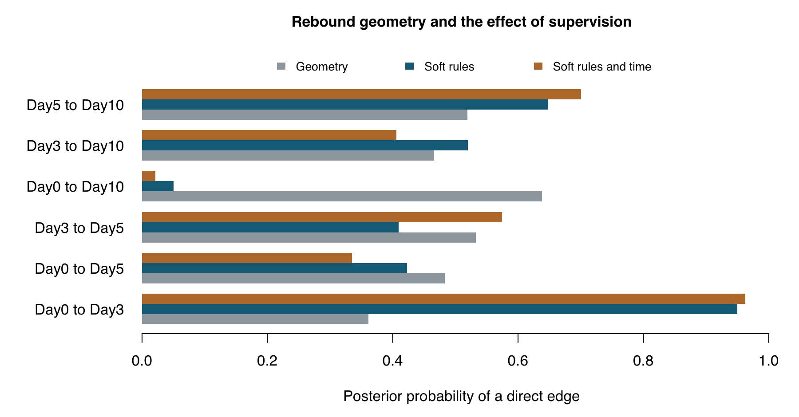

# TConstrain 0.1.0 framework and validation report

Validation date: 10 October 2026. Baseline: `0d55701596ac1f0b3584b7e934112a2036714500`.
The changes replace heuristic soft weighting with a conditional probabilistic
model of observed centroid coordinates and enforce hard rules exactly.

## Model and implementation

For K observed d-dimensional centroids, anchor one centroid and assume
independent N(0, sigma^2 I) increments on the K-1 edges of a candidate tree.
The conditional likelihood is the product of the normalized Gaussian densities;
its log includes `-(K-1)*d/2*log(2*pi*sigma^2)` and the negative squared edge
lengths divided by `2*sigma^2`. A rooted tree's increment-to-coordinate transform
has unit absolute Jacobian. No raw counts or latent ancestral states are fitted.

An edge log-prior factor is a signed `log(prior_strength)` for soft pair rules,
minus `time_strength * abs(time difference) / time_scale` for known times.
`Z0` sums these prior weights over all trees in the feasible hard support.
`Z1` sums prior times likelihood over the same support. Consequently the
normalized prior is `exp(sum(edge log priors))/Z0`, the normalized posterior is
`exp(sum(edge log priors + edge log likelihoods))/Z1`, and conditional log
evidence is `log(Z1)-log(Z0)`. Tree probabilities use complete tree scores;
edge marginals are dependent and cannot be multiplied to score a tree.

Required edges are contracted, forbidden edges removed, and parallel edges
retained. The weighted matrix-tree theorem supplies normalizers and
conductance-times-effective-resistance supplies edge marginals. A constrained
Kruskal optimization reports one MAP tree, including when multiple MAPs tie.
The prior normalizer cancels for fixed-prior MAP ranking, but is essential for
a valid prior and for model evidence. See the framework vignette for equations.

The dense algorithm uses O(K^2) memory and O(K^3) matrix algebra. Log-weight
shifts, Cholesky factorization, reciprocal-condition checks and marginal
checks guard the calculation. It errors on numerical underflow or a reciprocal
condition estimate below 1e-12 instead of silently pruning supported trees.

Hard cannot-links are literal exclusions. Hard must-links must be a feasible
forest, and the remaining support must connect all vertices. Conflicts,
self-rules, unknown IDs and malformed inputs error; identical undirected
rules are collapsed with a warning. Zero-distance edges, one-dimensional
coordinates and singleton trees work. Forest distributions are not implemented.

## Executed validation

Environment: R 4.4.3, igraph 2.3.4, macOS arm64. See `results/sessionInfo.txt`.

- `testthat`: 197 passed expectations, no failures, warnings or skips.
- `R CMD build`: passed, including both vignettes.
- `R CMD check --no-manual`: passed with status OK, including installed-package
  tests, documentation, examples and vignette rebuilds. PDF manual generation
  was not part of this check.
- Exhaustive enumeration for 2 to 5 vertices compared normalizers, MAP mass,
  evidence and edge marginals, including hard inclusions/exclusions and
  contracted parallel edges. The largest recorded normalizer error was
  2.665e-15; the largest recorded edge-marginal error was 7.772e-16.
- Uniform coincident geometry on 5 vertices gives 125 trees, each with
  probability 1/125, and each edge has probability 2/5.
- Regression checks cover impossible cycles, disconnected support, duplicate
  and contradictory rules, zero distances, invalid values, singleton/1D data,
  wrapper propagation, negative MAP costs, scale transformations and RNG safety.

## Model-based simulation and negative control

Seed 20261010; 400 independent replicates. Each replicate selects a uniformly
random labeled tree on 4 vertices, anchors A at zero, and generates independent
two-dimensional standard-normal increments on its edges. Fitting uses the
correct fixed sigma of 1, a uniform tree prior and no supplied true edges.

| Metric | Result |
|---|---:|
| Mean posterior edge Brier score | 0.195743 |
| Uniform-prior Brier score | 0.250000 |
| Coverage of a discrete 90% tree credible set | 91.5% |
| Mean MAP recall of true edges | 68.75% |

The Brier score measures probabilistic edge prediction, with lower values
better. A credible set includes complete trees in decreasing posterior order
until at least 90% mass is reached; finite discrete sets can exceed 90% mass.
Edges within a replicate are dependent. These are model-based numerical checks,
not a real-data scRNA-seq benchmark or proof of biological calibration.

For a separate illustrative chain with coordinates A=0, B=1, C=2, D=3, a
strong incorrect soft A-D must-link (strength 10000) increases its posterior
edge probability from 3.42% to 99.72%, and changes the MAP from three to two
true chain edges. A correct A-B rule at strength 100 gives 2.33% for A-D.
This exposes prior sensitivity, not a claim that priors automatically improve
recovery. The incorrect-edge posterior can be high while whole-tree MAP mass
is only 25.29%.



## Rebound example

The original four-cluster geometry and old strength 20 heuristic yield two
optimal trees with the same cost, 99.50491967. This was reproduced by enumerating
all 16 trees. The revised analysis uses sigma=5; soft strength=20; and, in the
last model, time strength=1 and time scale=5 days. These are illustrative
settings, not calibrated developmental parameters.

| Model | Day0-Day10 posterior | MAP tree probability | Log evidence |
|---|---:|---:|---:|
| Geometry only | 63.81% | 10.92% | -16.6083 |
| Soft pair rules | 5.03% | 20.80% | -17.1101 |
| Soft pair rules and time | 2.12% | 35.75% | -17.1013 |

Pair-only supervision still leaves two equally probable MAP trees. Adding
absolute time-gap supervision selects the chronological chain as the MAP,
but its mass is only 35.75%. The Day3-Day5 edge has probability 57.48%, so
substantial topology uncertainty remains. Geometry-only has higher coordinate
evidence in this example: the supervised chain reflects the supplied assumptions,
not demonstrated improvement of coordinate fit or biological accuracy.



The 24-setting sensitivity grid varies sigma over 2, 5 and 10, pair strength
over 1, 5, 20 and 100, and time strength over 0 and 1. Shortcut probability
ranges from 0.29% to 95.79%, illustrating why a single tuned picture is inadequate.

Indicative fitting times on this machine were 0.001 s for 10 clusters,
0.003 s for 50 and 0.014 s for 100. These single timings are neither a scaling
study nor a performance guarantee.

## Migration and scientific boundaries

`probabilistic=TRUE` now dispatches to the Gaussian posterior model; old
multiplier-based output is intentionally not reproduced. `prior_strength`
now specifies tree weight ratios. Set `likelihood_scale` explicitly and test
sensitivity. `time_strength=0` disables time supervision by default while
retaining unique-earliest-root selection. `small_eps` and `large_value` are
ignored with deprecation warnings. Original public wrappers remain available.

The default sigma is 1 coordinate unit and is not learned. Changing coordinate
scale requires changing sigma consistently. The reported evidence is a
conditional density and must be compared only on the same observation space,
units, dimensions, anchor and likelihood. Parameters selected from the same
fit are empirically tuned, not integrated out in a hierarchical Bayesian model.

For B-cell maturation, use cluster adjacency as a hypothesis. Shared BCR
clonotype does not itself establish direct adjacency. Evaluate withheld donor,
time and lineage information; separate resampling stability from conditional
posterior mass. A tree still cannot represent GC recurrence, convergence,
missing historical states, or a mixture of disconnected developmental systems.
This release supplies neither cell pseudotime nor a downstream curve adapter.
It does not model raw counts, centroid sampling uncertainty, donor variation,
branch-specific diffusion or uncertainty in embedding/clustering. No real
B-cell dataset or held-out biological measurements were used in this validation.

## Reproduction and sources

From an installed checkout:

```sh
Rscript -e 'testthat::test_local()'
Rscript validation/run_validation.R
Rscript validation/plot_results.R
R CMD build .
R CMD check --no-manual TConstrain_0.1.0.tar.gz
```

`results/` includes exhaustive-enumeration errors, the original example's tree
costs, posterior edge audits, sensitivity, calibration, replicate-level edges,
negative controls, timing and session information. The added GitHub workflow
runs package checks on pushes and pull requests.

- Baseline implementation: [TConstrain at 0d55701](https://github.com/JerryVujicic/TConstrain/tree/0d55701596ac1f0b3584b7e934112a2036714500).
- Meila and Jaakkola, *Tractable Bayesian Learning of Tree Belief Networks*,
  UAI 2000: [paper](https://arxiv.org/abs/1301.3875). Basis for tractable
  normalization of factored tree distributions; the coordinate likelihood
  in this package is its own stated model.
- igraph [edge-list construction](https://r.igraph.org/reference/graph_from_data_frame.html)
  and [minimum spanning trees](https://r.igraph.org/reference/mst.html).
- R [package build and check documentation](https://search.r-project.org/R/refmans/utils/html/PkgUtils.html).
